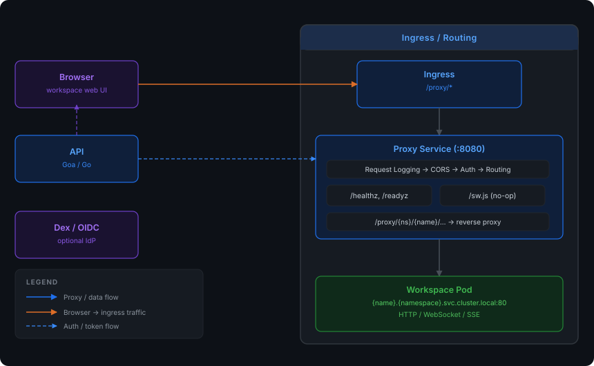

# Kube Workspaces Proxy

[](https://github.com/kube-workspaces/proxy/blob/main/LICENSE)
[](https://github.com/kube-workspaces/proxy/blob/main/go.mod)
[](https://github.com/kube-workspaces/proxy/releases)
[](https://github.com/kube-workspaces/proxy/actions/workflows/ci.yml)
[](https://github.com/kube-workspaces/proxy/actions/workflows/docker.yml)

Reverse proxy service for [Kube Workspaces](https://github.com/kube-workspaces). Routes browser traffic to workspace pods running in Kubernetes, with per-request authentication and namespace-level access control.

## Overview

The proxy sits between the ingress controller and workspace pods, handling:

- **Authentication** — validates `kw-session` HMAC-SHA256 tokens (cookie or Bearer header)
- **Authorization** — checks namespace access per request via User CRs (no caching = instant revocation)
- **Reverse proxying** — routes to workspace Services via cluster DNS
- **Protocol support** — HTTP, WebSocket, and SSE passthrough
- **Per-image behavior** — configurable backend port, TLS backends, path prefix preservation, HTML rewriting, audio port routing

## Architecture

[](docs/architecture.svg)

## Request Flow

1. Browser requests `/proxy/{namespace}/{name}/{path...}`
2. Auth middleware extracts token from `kw-session` cookie (or `Authorization: Bearer`)
3. Token signature verified against signing key from `AuthConfig` Secret
4. User CR looked up by email (fresh on every request)
5. Namespace access checked: admin role, personal namespace, or explicit `spec.namespaceAccess[]`
6. Workspace CR fetched to determine container image
7. Image CR matched to load proxy configuration (cached 30s)
8. Request forwarded to `http://{name}.{namespace}.svc.cluster.local:80/{path}`
9. Response headers rewritten (Location, Set-Cookie path)
10. `kw-proxy-prefix` cookie set on HTML responses for escaped request recovery

## Getting Started

### Prerequisites

- Go 1.26+
- Access to a Kubernetes cluster with Kube Workspaces CRDs installed
- `AuthConfig` CR (singleton named `default`) — auth can be disabled

### Run Locally

```bash
# With KUBECONFIG pointing to your cluster
go run ./cmd/proxy/ --port=8091

# Or build and run
go build -o bin/proxy ./cmd/proxy/
./bin/proxy --port=8091
```

### Environment Variables

| Variable | Default | Description |
|----------|---------|-------------|
| `HTTP_PORT` | `8080` | Server listen port |
| `PATH_PREFIX` | `/proxy` | URL path prefix for proxy routes |
| `ALLOWED_ORIGINS` | (none) | Comma-separated CORS allowed origins |
| `KUBECONFIG` | (in-cluster) | Path to kubeconfig file (local dev) |
| `AGENT_API_URL` | (none) | Trusted API origin for agent grants and premium observer membership/discovery |
| `DISPLAY_API_URL` | (none) | Trusted API origin for interactive display ownership |

### Command-Line Flags

```
--port=8080    Server listen port (overrides HTTP_PORT)
```

## Authentication

The proxy validates the same session tokens as the API service. Authentication is **opt-in** — when `AuthConfig.spec.enabled` is `false` (the default), all requests pass through without auth checks.

### Token Format

```
base64url(JSON payload) . base64url(HMAC-SHA256 signature)
```

The signing key is read from a Kubernetes Secret referenced by `AuthConfig.spec.session.signingKey`.

### Token Sources (checked in order)

1. `kw-session` HTTP cookie
2. `Authorization: Bearer <token>` header

### Access Control

| Role | Access |
|------|--------|
| Admin | Full access to all namespaces |
| Editor/Viewer | Access to personal namespace + explicitly assigned namespaces |
| Disabled user | Rejected (403) |

User CRs are looked up **fresh on every request** — disabling a user or revoking namespace access takes effect immediately.

## Proxy Features

### Path Prefix Preservation

For applications that support base URL configuration (e.g., linuxserver/webtop with `SUBFOLDER`), the proxy can forward the full path prefix to the backend:

```
# Normal mode (default): strips /proxy/{ns}/{name}
Request:  /proxy/team/my-code/file.js
Backend:  /file.js

# Preserve mode (annotation: kubeworkspaces.io/preserve-path-prefix=true):
Request:  /proxy/team/my-code/file.js
Backend:  /proxy/team/my-code/file.js
```

### Backend Port

By default the proxy targets the workspace Service port `80` (which the
controller maps to the image's primary guest port). An Image CR can set
`spec.proxyConfig.port` to route non-audio traffic at a different workspace
Service port — e.g. a web app exposed via an additional Service port alongside
SSH on the primary:

```
# spec.proxyConfig.port: 8080
Request:  /proxy/team/my-app/
Backend:  http://my-app.team.svc.cluster.local:8080/
```

`audioPort` still wins for `/audio/` paths. Unset (`0`) keeps the default 80.

### Audio Port Routing

Image CRs can define an `audioPort` in `spec.proxyConfig`. Requests to `/audio/` within a workspace are routed to this alternate Service port:

```
Request:  /proxy/team/my-desktop/audio/stream
Backend:  http://my-desktop.team.svc.cluster.local:6902/audio/stream
```

### Escaped Request Recovery

Some applications (e.g., KasmVNC WebSocket at `/websockify`) make requests that "escape" the proxy prefix. The proxy recovers these using:

1. `Referer` header — extracts the proxy prefix from the referring page
2. `kw-proxy-prefix` cookie — fallback when Referer is absent

### HTML Response Rewriting

On HTML responses, the proxy:
- Sets the `kw-proxy-prefix` cookie (for escaped request recovery)
- Injects `<base>` tags when configured (`injectBaseTag` in Image CR)

### WebSocket Support

WebSocket connections are proxied transparently. The `Upgrade` and `Connection` headers are passed through. Image CRs can declare known WebSocket paths in `spec.proxyConfig.websocketPaths`.

### Premium display observers

An Image with `spec.proxyConfig.agentPort` exposes the framed agent bridge at
`/proxy/{namespace}/{name}/agent/`. `purpose=v1.display` holds the exclusive
interactive seat and guest connection. `purpose=v1.observe` joins its encoded
H.264/Opus output through the proxy, using the API's shared-display membership
gate (`KW_DISPLAY_SHARED=on` on the API).

Observers obtain no guest tickets and cannot inject input, change clipboard,
resize the guest or configure the encoder. Each reader is bounded to 32 queued
frames / 16 MiB; overflow or a blocked write detaches that reader. Late joins
wait for a fresh IDR with SPS/PPS; proxy-owned keyframe demand is coalesced to
one request per second so an idle desktop can bootstrap without replaying stale
video. At most seven observers share a controller. Controller loss or revocation
ends the generation; control changes use the existing consented Tier 1 takeover.

The seat records the owning proxy pod. Requests landing on another replica make
one authenticated hop to that pod, resolved through Kubernetes in the platform
namespace and checked against the proxy release/service account. The proxy's
namespaced Role therefore needs `get` on `pods`, as included in the deployment
manifests. Single-replica readers do not require a peer lookup.

### TLS Backends

When `spec.proxyConfig.tlsInsecure: true` is set on an Image CR, the proxy connects to the backend over TLS with certificate verification disabled (for self-signed certs common in VNC/desktop images).

### CORS

Configurable via the `ALLOWED_ORIGINS` environment variable. Supports preflight (`OPTIONS`) requests.

## Kubernetes Resources Accessed

| Resource | Scope | Access | Caching |
|----------|-------|--------|---------|
| `AuthConfig` (kubeworkspaces.io/v1alpha1) | Cluster | Read | 30s |
| `User` (kubeworkspaces.io/v1alpha1) | Cluster | Read | None (fresh per request) |
| `Workspace` (kubeworkspaces.io/v1alpha1) | Namespaced | Read | 10s |
| `Image` (kubeworkspaces.io/v1alpha1) | Cluster | Read | 30s |
| `Secret` | Namespaced | Read | With AuthConfig (30s) |
| `Pod` | Platform namespace | Get | None (premium observer owner resolution) |

The Kubernetes client is configured with QPS=50 and Burst=100 to prevent rate-limiting delays under load.

## Docker

### Build

```bash
docker build -t ghcr.io/kube-workspaces/proxy:latest .
```

### Run

```bash
docker run -p 8080:8080 \
  -e ALLOWED_ORIGINS="https://workspaces.example.com" \
  -v ~/.kube/config:/home/nonroot/.kube/config:ro \
  ghcr.io/kube-workspaces/proxy:latest
```

The production image uses `distroless/static:nonroot` (runs as UID 65532).

## Project Structure

```
cmd/proxy/
  main.go              # Entrypoint, server setup, middleware chain
internal/
  auth/
    config.go          # AuthConfig/User CR loading, namespace access checks
    middleware.go      # HTTP auth middleware
    token.go           # HMAC-SHA256 token validation
  k8s/
    client.go          # Kubernetes dynamic client, Image/Workspace caching
  proxy/
    proxy.go           # Reverse proxy handler, response rewriting
Dockerfile             # Multi-stage build (golang → distroless)
```

## Related Repositories

| Repository | Role |
|-----------|------|
| [kube-workspaces/controller](https://github.com/kube-workspaces/controller) | Defines CRDs, manages workspace lifecycle |
| [kube-workspaces/api](https://github.com/kube-workspaces/api) | REST API for workspace CRUD, issues session tokens |
| [kube-workspaces/frontend](https://github.com/kube-workspaces/frontend) | Web UI that navigates users to proxy URLs |
| [kube-workspaces/deploy](https://github.com/kube-workspaces/deploy) | Helm/Kustomize deployment manifests |

## License

See [LICENSE](LICENSE).
